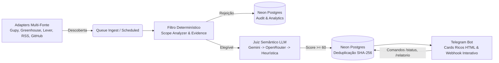

# Haadar

> Radar serverless de descoberta e qualificação de vagas de tecnologia operando em tempo real na borda (Cloudflare Workers Edge) integrado com banco relacional serverless (Neon PostgreSQL), inteligência artificial semântica e bot interativo no Telegram.

---

## 🌐 Visão Geral do Sistema

O **Haadar** foi concebido para resolver o problema da busca passiva por empregos. Em vez de depender de checagens manuais ou crawlers pesados que exigem servidores dedicados 24/7, o Haadar opera como um **radar distribuído orientado a eventos (EDA)** com cold-start de ~2 ms, custo operacional zero e entrega instantânea de oportunidades no Telegram com filtros rigorosos de senioridade, stack e evidência.



---

## ⚡ Diferenciais de Engenharia

- **Arquitetura Serverless Edge-Native:** 100% hospedado no Cloudflare Workers, operando nos limites gratuitos da plataforma por design, sem VPS ou containers ativos consumindo energia ociosos.
- **Pipeline de Filtros em Cascata (Clean Architecture):**
  1. *Filtro de Evidência:* Classifica anúncios como `LOW`, `MEDIUM` ou `HIGH_EVIDENCE`, evitando desperdício de tokens em vagas fantasmas ou rasas.
  2. *Filtro Determinístico:* Rejeição estrita de barreiras eliminatórias (vagas afirmativas PCD, superior obrigatório, senioridade sênior/lead, localidade fora da região Tatuí/Sorocaba para presencial).
  3. *Juiz Semântico com Fallback Heurístico:* Avaliação de fit cultural e stack via LLM (`Gemini Flash` com fallback automático para `OpenRouter` e cálculo determinístico caso a cota se esgote).
- **Idempotência & Deduplicação por Fingerprint:** Algoritmo SHA-256 invariante (`identity_fingerprint`). Uma vaga idêntica descoberta na Gupy e no LinkedIn é correlacionada e nunca alertada duas vezes.
- **Bot Interativo com Webhook Criptografado:** O bot não apenas envia alertas de vagas aprovadas, mas atua como um assistente completo recebendo comandos (`/status`, `/relatorio`, `/ultimas`, `/fontes`, `/problemas`, `/ajuda`) e links colados pelo celular.
- **Relatório Diário de Funil:** Rotina agendada (Cron às 20h BRT) com agregação SQL em janela deslizante de 24 horas no Neon PostgreSQL reportando taxas de conversão e motivos frequentes de rejeição.

---

## 📊 Matriz de Fatias Verticais Entregues

| Slice | Módulo | Status | Descrição & Garantias |
|---|---|---|---|
| **0** | **Governança & Neon Skeleton** | 🟢 Entregue | Conexão serverless com Neon via `@neondatabase/serverless`, `/health/db` e migrations. |
| **1** | **Esquema de Dados & Deduplicação** | 🟢 Entregue | Deduplicação atômica no Postgres (`ON CONFLICT (fingerprint)`), controle de ocorrências e rotinas de TTL. |
| **2** | **Transplante do Cérebro (Profile)** | 🟢 Entregue | Avaliador de perfil em TypeScript com regras determinísticas para Júnior/Pleno, stack e barreiras. |
| **3** | **Pipeline de Ingestão Multi-Fonte** | 🟢 Entregue | Adapters (Gupy, Greenhouse, Lever, Trampos, RSS, GitHub Issues) unificados com auditoria de descartes. |
| **4** | **Juiz Semântico (LLM Judge)** | 🟢 Entregue | Cadeia de resiliência: Gemini $\rightarrow$ OpenRouter $\rightarrow$ Heurística, com timeouts controlados. |
| **5** | **Telegram Rico & Webhook Manual** | 🟢 Entregue | Layout HTML com aderência de stack e webhook autenticado com segredo criptográfico. |
| **6** | **Virada de Chave & Cloud 100%** | 🟢 Entregue | Aposentadoria de serviços locais do systemd/SQLite; radar 100% autônomo na nuvem. |
| **7** | **Densidade de Evidência & Funil 24h** | 🟢 Entregue | Profiler de evidência para LinkedIn/ATS, novas fontes de comunidade e endpoint `/admin/daily-report`. |
| **8** | **Comandos Interativos do Bot** | 🟢 Entregue | Webhook bidirecional no Telegram para execução de `/start`, `/status`, `/relatorio`, `/ultimas`, `/fontes` e `/problemas`. |

---

## 🛠️ Comandos do Bot no Telegram

| Comando | Descrição |
|---|---|
| `/start` ou `/ajuda` | Apresenta as instruções do radar e a lista de comandos. |
| `/status` | Exibe a saúde operacional da Cloudflare, conectividade com Neon Postgres e total de vagas monitoradas. |
| `/relatorio` | Gera o balanço das últimas 24 horas (vagas catalogadas, alertas disparados e top motivos de descarte). |
| `/ultimas` | Lista as últimas 5 decisões tomadas pelo radar com data/hora no fuso de Brasília e o motivo da recusa. |
| `/fontes` | Mostra a distribuição e o volume de vagas descobertas por fonte no dia. |
| `/problemas` | Diagnóstico dos maiores gargalos de incompatibilidade encontrados nas vagas de hoje. |
| *Qualquer URL* | Envie o link de uma vaga (LinkedIn, Gupy, etc.) e o radar analisa e responde na hora. |

---

## 🧪 Qualidade, Segurança & Testes

O projeto segue rigorosamente o padrão **TDD (Test-Driven Development)** e esteira de CI/CD protegida por gates de auditoria:

- **Suíte de Testes:** 36 arquivos e 146 testes unitários e de integração executados no ambiente Miniflare/Vitest.
- **Detector Automatizado de Segredos:** Script executado a cada commit/PR que barra qualquer vazamento de credenciais ou tokens.
- **Auditoria Independente com Veto:** Subagentes revisores avaliam cada Pull Request sob 5 lentes (Segurança, Tipagem Estrita, Resolução de Causa Raiz, Testes Reais e Rastreabilidade).
- **TypeScript Strict:** 100% livre de erros no `npx tsc --noEmit`.

```bash
# Executar a suíte de testes completa
npx vitest run --fileParallelism=false

# Validar tipagem estrita
npx tsc --noEmit

# Executar scanner de segredos
node scripts/check-secrets.js
```

---

## 🚀 Como Executar Localmente

### Pré-requisitos
- Node.js 22+
- Conta Cloudflare (com Workers e D1/Queues ativos)
- Instância Neon PostgreSQL Serverless

### Configuração
1. Instale as dependências:
   ```bash
   npm ci
   ```
2. Configure as variáveis de ambiente (consulte `.env.example`):
   ```bash
   cp .env.example .dev.vars
   ```
3. Inicie o ambiente de emulação local:
   ```bash
   npx wrangler dev
   ```

---

## 🏛️ Decisões Arquiteturais (ADRs)

- [ADR-001: Persistência Serverless no Neon PostgreSQL vs. SQLite Local](docs/BACKLOG.md)
- [ADR-002: Filtro Determinístico Prévio à Invocação de LLM](docs/TRACEABILITY.md)
- [ADR-003: Deduplicação por Fingerprint SHA-256 e Desacoplamento de Conteúdo](docs/TRACEABILITY.md)
- [ADR-004: Pipeline de Avaliação em Multi-Estágio com Densidade de Evidência](docs/TRACEABILITY.md)
- [ADR-005: Webhook Seguro com Secret Token para Comandos Interativos](docs/TRACEABILITY.md)

---

## 📄 Licença

Distribuído sob a licença MIT. Consulte `LICENSE` para mais detalhes.
